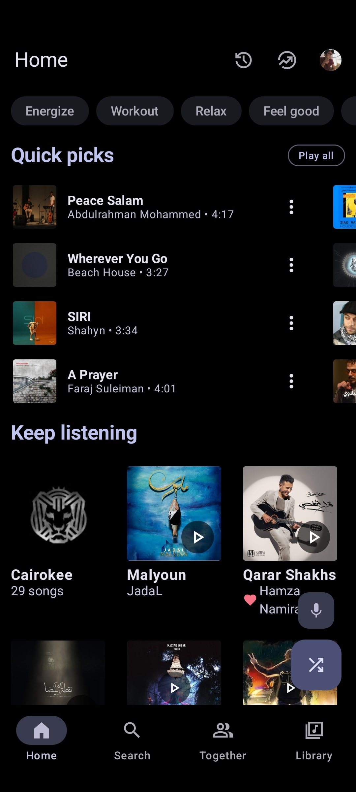
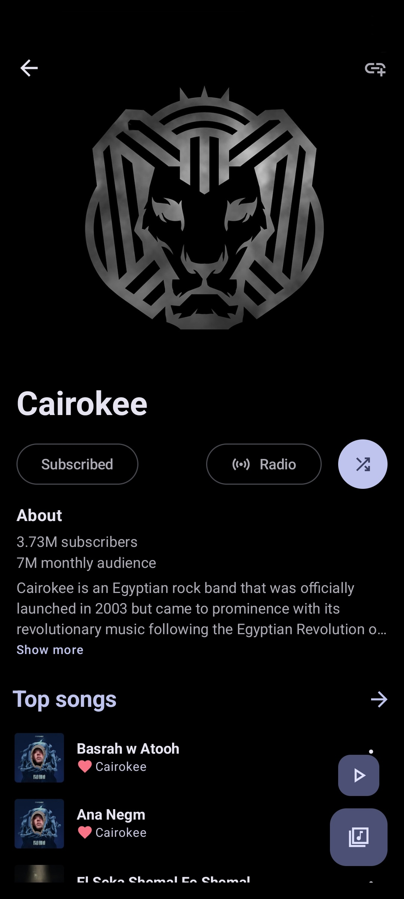
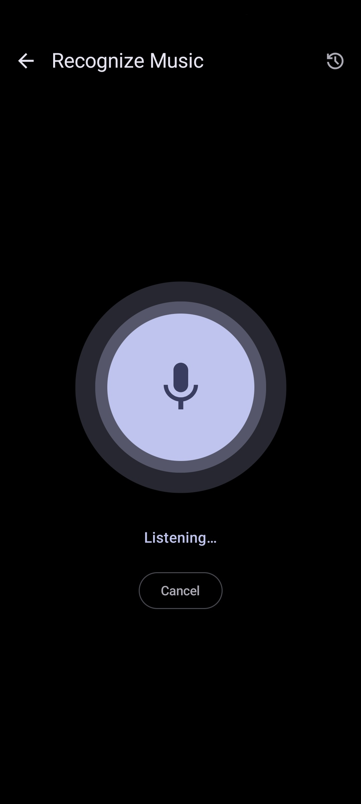
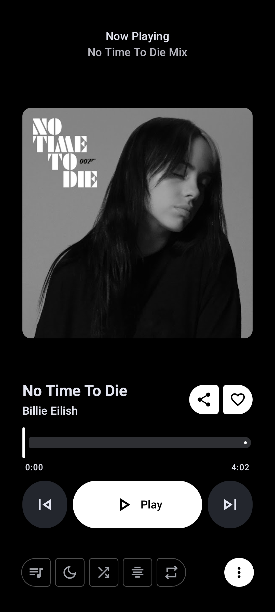
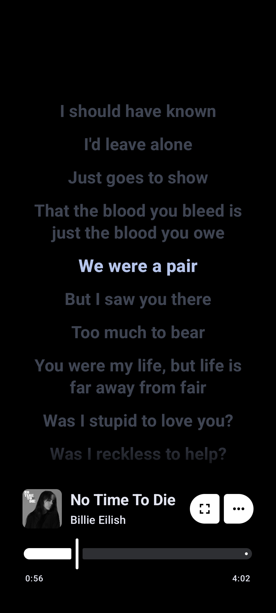

# Metrolist

### Client YouTube Music pour Android

 

 

[**Télécharger**](#telecharger) · [**Fonctionnalités**](#fonctionnalites) · [**Traductions**](#traductions) · [**FAQ**](#faq) · [**Soutenir le projet**](#soutenir)

> [!NOTE]
> **Version personnelle maintenue par anderson76389.** Les sources, les publications et le journal des modifications sont gérés dans ce dépôt. Le nom et le logo Metrolist sont conservés.

> [!IMPORTANT]
> **Vérifications réelles — 21 octobre 2026 :** compilation, démarrage Android, lecture hors connexion, quatre tests d’export audio (dont les sous-dossiers Albums/Playlists), six catégories de paramètres, 26 interrupteurs, trois choix de qualité et journal GitHub validés. Liquid Glass retiré. L’essai YouTube anonyme a été refusé par l’anti-robot ; le téléchargement avec compte n’est pas certifié par ces tests. [Consulter les résultats et leurs limites](VERIFICATION-FONCTIONS.txt).

> [!WARNING]
> **Disponibilité régionale** — L’accès au catalogue dépend de la disponibilité de YouTube Music dans votre région et des restrictions du service.

---

<h1>Captures d’écran</h1>

Captures de présentation héritées de l’interface d’origine, conservées dans ce dépôt. Elles illustrent l’interface et ne constituent pas une preuve de test de la préversion actuelle.

---

<h1>Fonctionnalités</h1>

<table>
  <tr>
    <td width="50%" valign="top">

#### Lecture

- Écoute des morceaux et vidéos disponibles sur YouTube Music
- Lecture en arrière-plan
- Téléchargements et cache pour l’écoute hors connexion
- Suppression des silences
- Minuterie de mise en veille

</td>
    <td width="50%" valign="top">

#### Audio

- Normalisation du volume
- Réglage du tempo et de la hauteur tonale
- Égaliseur
- Fondu enchaîné
- Qualité élevée sélectionnée par défaut

</td>
  </tr>
  <tr>
    <td width="50%" valign="top">

#### Paroles et découverte

- Paroles synchronisées
- Romanisation locale des paroles
- Suggestions rapides personnalisées
- Recherche de morceaux, albums, artistes, vidéos et listes de lecture
- Reconnaissance musicale

</td>
    <td width="50%" valign="top">

#### Bibliothèque et compte

- Gestion de la bibliothèque
- Listes de lecture locales
- Importation de listes de lecture
- Réorganisation des morceaux dans une liste ou la file d’attente
- Connexion au compte YouTube Music
- Synchronisation des morceaux, artistes, albums et listes de lecture

</td>
  </tr>
  <tr>
    <td width="50%" valign="top">

#### Fichiers audio

- Moteur yt-dlp embarqué
- Enregistrement dans un dossier Android choisi
- Conservation du flux d’origine, sans réencodage
- Suivi et annulation des téléchargements
- Mode hors connexion interne conservé séparément

</td>
    <td width="50%" valign="top">

#### Interface

- Widget sur l’écran d’accueil
- Thèmes clair, sombre, noir et dynamique
- Couleurs dynamiques et palettes prédéfinies
- Interface Material 3
- Google Cast dans l’APK universel

</td>
  </tr>
</table>

Fonctions présentes dans le code. Leur disponibilité peut dépendre du compte, de YouTube, des fournisseurs de paroles ou du matériel. Le périmètre effectivement testé est détaillé dans le rapport.

---

<h1>Télécharger maintenant</h1>

<h2>Préversion vérifiée</h2>

<table>
  <tr>
    <th align="center">GitHub — un seul APK universel</th>
  </tr>
  <tr>
    <td align="center">
      
    </td>
  </tr>
</table>

**[Télécharger Metrolist — dernière version signée](https://github.com/anderson76389/Music/releases/latest/download/Metrolist.apk)**

Android 8.0 minimum · ARM 32/64 bits et x86 32/64 bits · Google Cast inclus

[Notes de cette version](https://github.com/anderson76389/Music/releases/latest) · [Toutes les versions](https://github.com/anderson76389/Music/releases) · [Tests réussis](https://github.com/anderson76389/Music/actions/runs/39346281661)

Installez **`Metrolist.apk`** directement. Les sources et les sommes de contrôle jointes ne sont pas des versions supplémentaires de l’application.

Chaque modification du code sur `main` lance les contrôles. Après leur réussite, une seconde étape construit et vérifie les APK signés, puis publie **un seul Metrolist.apk universel** dans Releases. Les numéros de version augmentent automatiquement. Les deux variantes sont compilées en interne pour les essais de compatibilité.

> [!IMPORTANT]
> **Passage des anciennes préversions à la version signée :** la version publique utilise `fr.makoff.music`, tandis que les anciens tests utilisent `fr.makoff.music.debug`. Les deux peuvent coexister. Sauvegardez vos données dans l’ancienne application, restaurez-les et vérifiez-les dans la nouvelle avant toute suppression. Les publications signées suivantes conservent la même clé.

<h2>Version stable</h2>

La publication utilise la clé privée du projet, conservée dans les secrets GitHub Actions. Le certificat public, les informations de construction, les sources et les sommes SHA-256 accompagnent l’APK. Les mises à jour utilisent exclusivement les Releases de ce dépôt.

---

<h1>Questions fréquentes</h1>

<h3>Une question ? Retrouvez les réponses ci-dessous et dans les guides du dépôt.</h3>

<strong>Toutes les fonctions sont-elles garanties ?</strong>

Les contrôles Android du 20 octobre 2026 ont réussi dans le périmètre décrit dans [VERIFICATION-FONCTIONS.txt](VERIFICATION-FONCTIONS.txt). Un interrupteur enregistré ne prouve pas son effet dans toutes les situations. La connexion et les flux YouTube authentifiés, Cast, Bluetooth, Android Auto, le microphone et toutes les combinaisons de réglages nécessitent encore des essais en conditions réelles.

<strong>Comment enregistrer les fichiers dans un dossier ?</strong>

Dans le menu d’un morceau ou du lecteur, choisissez **« Enregistrer un fichier audio (yt-dlp) »**, sélectionnez un dossier Android et autorisez son utilisation. Le suivi des tâches et le changement de dossier se trouvent dans **Paramètres → Stockage → Fichiers audio — yt-dlp**. Le téléchargement interne pour l’écoute hors connexion reste disponible séparément. [Guide complet](TELECHARGEMENTS-FICHIERS.txt).

<strong>Est-ce du M4A, de l’Opus ou du FLAC ?</strong>

M4A est un conteneur, généralement associé au codec AAC ; WebM peut contenir de l’Opus. L’application conserve le flux disponible sans fabriquer de FLAC par conversion. Le mode Élevée ne garantit pas 256 kbit/s pour tous les titres. L’export yt-dlp demande le meilleur flux audio disponible, indépendamment du réglage de qualité du lecteur. [Contrôles audio et explications](QUALITE-AUDIO.txt).

<strong>L’application dépend-elle encore d’un serveur du projet d’origine ?</strong>

L’audit ne détecte aucun point d’accès applicatif amont actif connu dans les modules contrôlés. Le moteur et le logo sont présents localement. YouTube/Google, GitHub et les fournisseurs tiers activés restent des services extérieurs ; leur pérennité n’est pas garantie par l’archivage du code. [Audit d’indépendance](docs/AUDIT-INDEPENDANCE.md).

---

<h1>Traductions</h1>

<h3>Metrolist propose plusieurs langues, dont le français.</h3>

Les ressources de traduction sont conservées dans les [sources de l’application](app/src/main/res). Pour signaler une formulation incorrecte, [ouvrez un ticket](https://github.com/anderson76389/Music/issues) en précisant l’écran concerné et le texte proposé.

<h3>Merci ! Chaque traduction rend l’application plus accessible.</h3>

---

<h1>Soutenir le projet</h1>

<h3>Metrolist est libre et open source. Vous pouvez soutenir cette version en signalant les problèmes et en partageant vos retours.</h3>

[Signaler un problème](https://github.com/anderson76389/Music/issues) · [Consulter les sources](https://github.com/anderson76389/Music) · [Voir les publications](https://github.com/anderson76389/Music/releases)

---

<h1>Remerciements</h1>

<h3>Cette application repose sur le travail de nombreux projets open source.</h3>

<table>
  <tr><th align="center">Composant</th><th align="center">Contribution</th></tr>
  <tr><td align="center"><strong>Moteur embarqué</strong></td><td>Accès aux données et aux flux YouTube Music ; sources conservées dans <a href="vendor/innertubex">vendor/innertubex</a>.</td></tr>
  <tr><td align="center"><strong>yt-dlp</strong></td><td>Téléchargement des flux audio pour l’export en dossier.</td></tr>
  <tr><td align="center"><strong>Fournisseurs de paroles</strong></td><td>Recherche des paroles et synchronisation selon les réponses disponibles.</td></tr>
  <tr><td align="center"><strong>Reconnaissance musicale</strong></td><td>Identification musicale via les services concernés.</td></tr>
</table>

<h3>Merci à la communauté pour les bibliothèques, outils et interfaces utilisés.</h3>

Les auteurs d’origine, les licences et la provenance des composants sont conservés dans [PROVENANCE.txt](PROVENANCE.txt), [LICENSE](LICENSE) et les notices des sources.

---

<h1>Contributeur de cette version</h1>

<h3><a href="https://github.com/anderson76389">anderson76389</a></h3>

Maintenance et développement de cette version personnelle.

---

<h1>Avertissement</h1>

Cette version personnelle n’est **ni affiliée à, ni financée, autorisée ou approuvée par YouTube ou Google LLC**, ni par leurs sociétés affiliées ou filiales.

Les marques et les droits de propriété intellectuelle mentionnés appartiennent à leurs propriétaires respectifs. Le code est distribué sous **GPL-3.0**, avec ses notices et licences.

---

 

**Maintenu avec ❤️ par [anderson76389](https://github.com/anderson76389)**

### Télécharger dans un dossier

Le bouton de téléchargement habituel conserve les titres dans le stockage privé de Metrolist pour la lecture hors connexion. Pour obtenir aussi des fichiers accessibles aux autres applications, ouvrez le menu du morceau et choisissez **Enregistrer un fichier audio (yt-dlp)**. Dans le menu d’un album ou d’une playlist, choisissez **Télécharger la collection dans un dossier**. Android vous demande un dossier de destination.

Les collections sont rangées dans `Albums/Nom [identifiant]/` ou `Playlists/Nom [identifiant]/`, avec des noms de pistes numérotés. Les deux modes sont indépendants : déclenchez chacun si vous voulez les deux copies. Les fichiers audio conservent le format fourni par la source, sans conversion artificielle en FLAC. L’accès aux titres reste soumis à leur disponibilité et à la réponse de YouTube.
